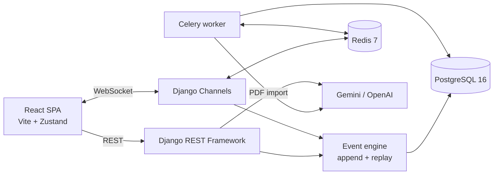

<div align="center">

# MindMesh

**Real-time, event-sourced collaborative assessment for classrooms.**

[](LICENSE)
[](CONTRIBUTING.md)


[Overview](#overview) · [Features](#key-features) · [Architecture](#architecture) · [Setup](#getting-started) · [API](#rest-api) · [Contributing](#contributing)

</div>

---

## Overview

MindMesh is a full-stack quiz platform for live, collaborative assessment. A host creates a
quiz, opens a room with a short code, and students join from their own devices. Answers,
confidence ratings, misconception clusters, and leaderboards update over WebSockets while the
session is running.

The backend is **event-sourced**: every session action is appended to an immutable `QuizEvent`
log, and the authoritative room state, scores, and analytics are derived by replaying that log.
The frontend is a React single-page application backed by Django REST Framework and Django
Channels. The project targets local development and self-hosting; it does not ship a production
deployment configuration.

## Key Features

- **Live rooms over WebSockets** — hosts push questions; participants answer in real time
  through Django Channels with a Redis channel layer.
- **Event-sourced session state** — events are persisted before they are broadcast. Room state,
  leaderboards, clusters, and history are recomputed by replaying the log.
- **Dual scoring model** — a speed-and-accuracy score plus a Brier-derived calibration score
  that rewards confident-correct answers and penalises confident-wrong answers.
- **Misconception analytics** — wrong options carry misconception tags; the backend clusters
  participants by tag and serves force-graph data to the host dashboard.
- **Self-paced student progression** — after the host starts a question, each student advances
  independently. Reconnecting students resume at their next unanswered question.
- **PDF-to-quiz import** — upload a PDF (maximum 5 MB, 20 pages) and receive streamed,
  page-by-page extraction of questions, options, explanations, and misconception tags.
- **AI hints and debriefs** — Celery tasks generate Socratic hints and a post-session debrief.
  A template debrief is produced when no LLM key is configured.
- **History and review** — session history, participant review, cluster graphs, branch-tree
  data, and stored debrief reports are available through the REST API.

## Architecture



### Event-sourced assessment flow

1. A host creates a quiz and a room. The room receives a six-character code and a host token.
2. A student joins over REST and receives a participant session token.
3. The client opens `ws/room/<code>/` and authenticates with the host or participant token.
4. The host pushes a question. The consumer writes a `question_shown` event **before**
   broadcasting it to the room.
5. Each answer writes an `answer_submitted` event with the participant, question, option,
   confidence, and latency. Scores and clusters are recomputed from the log and broadcast.
6. Pause, resume, reset, and end actions append `host_paused`, `host_resumed`, `session_ended`,
   and related events. Ending a session persists scores and queues debrief generation.
7. `replay_events()` rebuilds `RoomState` by applying events in sequence order; it is the single
   source of truth for leaderboards, history, and analytics.

> **Current scope:** the event model defines a `host_rewound` type, but the WebSocket consumer
> does not route a rewind command. Pause/resume and room reset are the wired host controls.

## Tech Stack

| Layer | Technology | Purpose |
|---|---|---|
| Frontend | React 19, Vite 8 | SPA and development server |
| Routing | React Router 7 | Client-side routes |
| State | Zustand 5 | Auth, quiz, room, and WebSocket stores |
| Visualisation | D3, react-force-graph-2d, Recharts, Framer Motion | Cluster/branch graphs and animations |
| API | Django 5.1, DRF 3.15 | REST endpoints and token auth |
| Realtime | Django Channels 4.1, channels-redis, Daphne | WebSocket consumers and ASGI serving |
| Database | PostgreSQL 16 | Relational data and the event log |
| Queue | Celery 5.4, Redis 7 | Hint and debrief generation |
| AI / PDF | Gemini API, OpenAI API, PyMuPDF | PDF extraction, hints, debrief narratives |

## Project Structure

```text
MindMesh/
├── backend/
│   ├── manage.py
│   ├── requirements.txt
│   ├── .env.example
│   ├── mindmesh/               # settings, URLs, ASGI router, Celery app
│   └── quiz/
│       ├── models.py           # Quiz, Question, Option, Room, Participant,
│       │                       # QuizEvent, Score, DebriefReport
│       ├── event_engine.py     # append_event, replay_events, leaderboard
│       ├── scoring.py          # standard and calibration scoring
│       ├── clustering.py       # misconception clusters and graph data
│       ├── branching.py        # adaptive branch selection
│       ├── consumers.py        # RoomConsumer WebSocket protocol
│       ├── views.py            # quiz and room REST views
│       ├── auth_views.py       # token auth
│       ├── student_views.py    # scores and creator discovery
│       ├── tasks.py            # Celery hint/debrief tasks
│       └── urls.py
├── frontend/
│   ├── package.json
│   ├── vite.config.js          # proxies /api and /ws to :8000
│   └── src/                    # pages, Zustand stores, graph components
├── docker-compose.yml          # PostgreSQL + Redis for local development
└── scratch/                    # exploratory API/WebSocket scripts
```

## Getting Started

### Prerequisites

- Python 3.10 or newer
- Node.js 18 or newer
- Docker with Compose **or** local PostgreSQL 16 and Redis 7
- Optional: Gemini API key for PDF import and hints; OpenAI API key for LLM debriefs

### 1. Clone and start backing services

```bash
git clone https://github.com/ishanvaidya01/MindMesh.git
cd MindMesh
docker compose up -d
```

`docker-compose.yml` provides only PostgreSQL (host port `5435`) and Redis (port `6379`).
If you use local services, update `DB_PORT` and `REDIS_URL` in `backend/.env`.

### 2. Configure and run the backend

```bash
cd backend
python -m venv .venv
# Windows: .venv\Scripts\activate
# macOS/Linux: source .venv/bin/activate
pip install -r requirements.txt
copy .env.example .env        # Windows; use cp on macOS/Linux
```

Edit `backend/.env` and set at least `DJANGO_SECRET_KEY`. Then apply migrations and start the
ASGI development server:

```bash
python manage.py migrate
python manage.py createsuperuser   # optional, for /admin/
python manage.py runserver
```

The API is available at `http://localhost:8000`, Django admin at
`http://localhost:8000/admin/`. The PDF import path imports PyMuPDF, Pydantic, and
`google-genai`, which are not pinned in `requirements.txt`; install them explicitly to use it:

```bash
pip install "pymupdf>=1.24" "pydantic>=2.7" "google-genai>=1.0"
```

### 3. Start Celery (optional)

```bash
cd backend
celery -A mindmesh worker -l info
# Windows: add --pool=solo
```

Without a worker, hint and debrief jobs remain unprocessed; the rest of the app still runs.

### 4. Start the frontend

```bash
cd frontend
npm install
npm run dev
```

Open `http://localhost:5173`. Vite proxies `/api` and `/ws` to `http://localhost:8000`. Copy
`frontend/.env.example` to `frontend/.env` to override the API or WebSocket origin. Several page
modules also use `http://localhost:8000` directly, so keep the backend on port 8000 locally.

## Environment Variables

### Backend (`backend/.env`)

| Variable | Description | Default |
|---|---|---|
| `DJANGO_SECRET_KEY` | Django signing secret; set a unique value outside development | Insecure development key |
| `DJANGO_DEBUG` | Debug mode and permissive CORS | `True` |
| `DB_NAME` | PostgreSQL database name | `mindmesh` |
| `DB_USER` | PostgreSQL user | `postgres` |
| `DB_PASSWORD` | PostgreSQL password | `postgres` |
| `DB_HOST` | PostgreSQL host | `127.0.0.1` |
| `DB_PORT` | PostgreSQL port | `5435` |
| `REDIS_URL` | Redis URL for the Channels layer | `redis://127.0.0.1:6379/0` |
| `CELERY_BROKER_URL` | Celery broker URL | `redis://127.0.0.1:6379/1` |
| `CELERY_RESULT_BACKEND` | Celery result backend | `redis://127.0.0.1:6379/1` |
| `GEMINI_API_KEY` | Gemini key for PDF extraction and hints | empty |
| `OPENAI_API_KEY` | OpenAI key for LLM debrief narratives | empty |

### Frontend (`frontend/.env`)

| Variable | Description | Default |
|---|---|---|
| `VITE_API_URL` | REST base URL, including `/api` | `http://localhost:8000/api` |
| `VITE_WS_URL` | WebSocket origin | `ws://localhost:8000` |

## Usage

1. Register or sign in at `/auth`, or join a room as a guest with a display name.
2. Create a quiz at `/create`, or import questions from a PDF.
3. Open the host dashboard, choose a quiz, and create a room. Share the six-character code.
4. Students join at `/join` and answer questions with a confidence rating.
5. The host sees leaderboards, answer totals, misconception clusters, and student progress.
6. End the session to persist scores and queue a debrief. Review it from `/history`.

## REST API

All endpoints are rooted at `/api/`. Authentication uses DRF token auth:
`Authorization: Token <token>`.

### Authentication

| Method | Endpoint | Description |
|---|---|---|
| `POST` | `/api/auth/register/` | Register with `username`, `password`, optional `full_name` |
| `POST` | `/api/auth/login/` | Obtain a token with `username` and `password` |
| `POST` | `/api/auth/logout/` | Delete the current token (authenticated) |
| `GET` | `/api/auth/me/` | Current user (authenticated) |
| `POST` | `/api/auth/link-progress/` | Link a participant `session_token` to the current user |

### Quizzes

| Method | Endpoint | Description |
|---|---|---|
| `GET` | `/api/quizzes/` | List quizzes; optional `?creator_id=` filter |
| `POST` | `/api/quizzes/` | Create a quiz with nested questions and options |
| `GET` | `/api/quizzes/<uuid>/` | Retrieve a quiz with questions and options |
| `PUT/PATCH` | `/api/quizzes/<uuid>/` | Update a quiz |
| `DELETE` | `/api/quizzes/<uuid>/` | Delete a quiz |
| `POST` | `/api/quizzes/upload-pdf/` | Multipart PDF upload; streams SSE extraction results |

### Rooms

| Method | Endpoint | Description |
|---|---|---|
| `GET` | `/api/rooms/` | List rooms |
| `POST` | `/api/rooms/create/` | Create a room from `quiz` and `host` |
| `GET` | `/api/rooms/<code>/` | Room details, participants, current question |
| `POST` | `/api/rooms/<code>/join/` | Join with `display_name`; returns a session token |
| `GET` | `/api/rooms/<code>/history/` | Session history, leaderboard, clusters, branch path |
| `GET` | `/api/rooms/<code>/scores/` | Persisted scores for the room |
| `GET` | `/api/rooms/<code>/my-review/?session_token=` | One participant's answers and explanations |
| `GET` | `/api/rooms/<code>/clusters/?question_id=` | Misconception graph nodes and links |
| `GET` | `/api/rooms/<code>/branch-tree/` | Branch tree and path taken |
| `GET` | `/api/rooms/<code>/debrief/` | Debrief report, or `202` while pending |
| `POST` | `/api/rooms/<code>/reset/` | Host reset; requires `host_token` |

### Students and creators

| Method | Endpoint | Description |
|---|---|---|
| `GET` | `/api/student/scores/` | Authenticated user's scores |
| `GET` | `/api/creators/` | Users who have created quizzes |
| `GET` | `/api/creators/<id>/quizzes/` | Quizzes by a creator |

### WebSocket protocol

Connect to `ws://localhost:8000/ws/room/<code>/` and send JSON messages with a `type` field.

| Client message | Purpose |
|---|---|
| `authenticate` | Authenticate with `host_token` or `session_token` |
| `join_room` | Announce participant presence with `session_token` |
| `question_pushed` | Host pushes a question (or auto-selects the next one) |
| `answer_submitted` | Submit `option_id`, `confidence`, `latency_ms`, `question_id` |
| `host_pause` / `host_resume` | Host pauses or resumes the room |
| `end_session` | Host ends the session and persists scores |
| `student_advance` | Student requests their next self-paced question |
| `host_reset_room` | Host clears events and returns the room to the lobby |
| `request_hint` | Student requests a hint for a question |

Server messages include `state_sync`, `authenticated`, `participant_joined`, `question_pushed`,
`answer_confirmed`, `leaderboard_update`, `cluster_update`, `answer_stats`, `session_paused`,
`session_resumed`, `student_question`, `student_progress_update`, `student_quiz_complete`,
`room_reset`, `session_ended`, and `hint_delivered`.

## Testing

There is **no automated test suite** in this repository. The contents of `scratch/` are
exploratory scripts, not CI tests, and some payloads are out of date with current serializers.

Run the available static and smoke checks:

```bash
cd backend && python manage.py check
cd frontend && npm run lint && npm run build
```

Then exercise the main flow manually: register, create a quiz with at least two questions,
create a room, join from a second browser session, answer, pause/resume, end the session, and
inspect the history and debrief endpoints.

## Deployment and Limitations

The repository contains only a development `docker-compose.yml` for PostgreSQL and Redis. It
does not provide application containers, a reverse proxy, or a production settings module. If
you deploy separately, set a strong `DJANGO_SECRET_KEY`, disable `DEBUG`, restrict
`ALLOWED_HOSTS` and CORS, run an ASGI server and Celery worker, and serve the built frontend.

- No automated backend or frontend tests are included.
- PyMuPDF, Pydantic, and `google-genai` are imported by the PDF path but are not pinned in
  `requirements.txt`; install them separately as shown above.
- Rewind/lifeline event types exist in the model, but no WebSocket command emits them.
- Adaptive branch selection is backend-only; the main student flow advances linearly.

## Contributing

Contributions are welcome. Read [CONTRIBUTING.md](CONTRIBUTING.md) before opening a pull
request, and follow the [Code of Conduct](CODE_OF_CONDUCT.md). For security issues, follow
[SECURITY.md](SECURITY.md) instead of opening a public issue.

## License

Released under the [MIT License](LICENSE).

## Contact

**Ishan Vaidya**
- Email: [ishan.vaidya01@gmail.com](mailto:ishan.vaidya01@gmail.com)
- GitHub: [@ishanvaidya01](https://github.com/ishanvaidya01)
- Repository: [ishanvaidya01/MindMesh](https://github.com/ishanvaidya01/MindMesh)
